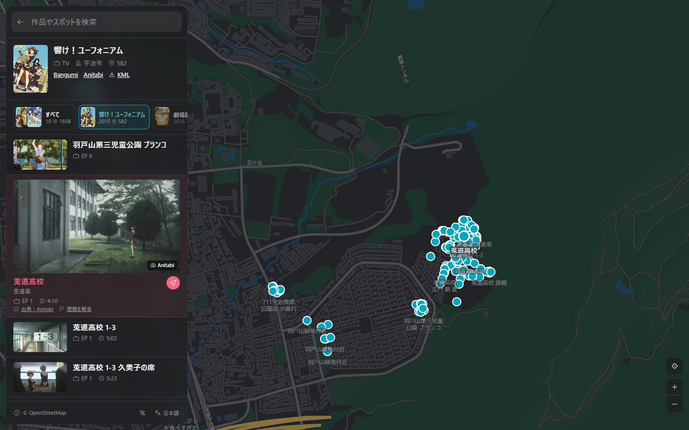

  

<h1 align="center">聖地巡礼マップ</h1>

<a href="https://junrei.jannchie.com">junrei.jannchie.com</a>

<a href="README.md">English</a> · <a href="README.zh-CN.md">简体中文</a> · 日本語

聖地巡礼マップは、アニメやゲームに登場した実在の場所を地図上に表示し、各スポットに対応する場面の画像、話数、時間、出典を添えたサイトです。旅行前のルート計画と、現地での場面の見比べに使うことを想定しています。

収録スポットは 5.5 万件以上、作品数は約 1,900 作品です。Bangumi に登録された 3.1 万件以上のアニメはすべて検索できます。表示言語は简体中文、繁體中文、日本語、English に対応しています。

## 作った理由

私は長く [Anitabi](https://www.anitabi.cn/map) を利用しており、そのデータは現在も本サイトの中心です。以下は、私が必要としていながら Anitabi では得られなかった点です。

- **作品数**：Anitabi に未収録の約 570 作品、3,400 スポットを、ファンの探訪記録と anime-tourism.jp をもとに手作業で追加しています（[データの出典](#データの出典)を参照）。
- **話数と時間**：判明しているスポットには、場面が登場する話数と時間を表示します。手作業で追加したスポットの多くは、trace.moe との画像照合によってこの 2 項目を求めており、本編で該当場面を探し直せます。
- **シリーズ単位の表示**：同じシリーズの各期、続編、劇場版、OVA を 1 ページにまとめて全スポットを表示し、特定の 1 作品に絞り込むこともできます。
- **表記の揺れに強い検索**：作品は中国語名、日本語の原題、英語名、ローマ字のいずれでも検索できます。簡体字と繁体字、日本の字体、ひらがなとカタカナ、全角と半角は相互に一致し、「聖地巡禮」で「圣地巡礼」も見つかります。
- **表示言語と現地の名称**：作品名、スポット名、備考は表示言語で示します。選択中のスポットには現地語の名称も表示し、現地の案内表示と照合できます。機械翻訳の文章にはその旨を表示します。
- **地図から旅程へ**：各スポットは Google マップまたは Apple マップで開いて経路を調べられます。作品ごとのスポットは KML として書き出し、Google マイマップに取り込めます。すべての画面に固有の URL があり、作品、スポット、検索結果をリンクで共有できます。

## 使い方

<https://junrei.jannchie.com> を開き、検索欄に作品名または地名を入力します。

- **エリアから探す**：トップページには、現在の地図の範囲内にスポットがある作品が表示されます。地図を動かすと周辺の作品に切り替わります。
- **スポットを見る**：一覧または地図上でスポットを選ぶと、場面の画像、話数と時間、短い説明、出典へのリンクが表示されます。
- **アプリとして使う**：スマートフォンのブラウザで「ホーム画面に追加」を選ぶと、ホーム画面から開けます。

パソコンでは `?` キーでキーボードショートカットの一覧を表示します。

成人向け作品（主に美少女ゲーム）のスポットも収録していますが、通常は表示されません。ページ下部の「© OpenStreetMap」ボタンを押し、表示されるメニューで「成人向け作品を表示」にチェックを入れると表示されます。

## データの出典

- [Anitabi](https://www.anitabi.cn/map)：スポットと場面画像の大部分。毎日同期しています。
- [Bangumi](https://bgm.tv)：作品情報、別名、カバー画像、シリーズ関係。[API](https://bangumi.github.io/api/) と毎週公開される[データアーカイブ](https://github.com/bangumi/Archive)を利用しています。
- [`sync/manual.json`](sync/manual.json) に手作業で追加したスポット（Anitabi 未収録の作品が対象）：
  - [舞台探訪アーカイブ](https://wikiwiki.jp/legwork/)：作品ごとに探訪記事をまとめた wiki と、そこに掲載されているファンの巡礼ブログ
  - Anitabi が出典として引用しているファンの巡礼ブログ
  - [錦鮒出版 聖地巡礼特集](https://nishikibuna.web.fc2.com/EXTRA/seichi.html)：美少女ゲームの探訪記録
  - [anime-tourism.jp](https://anime-tourism.jp)（Anime Tourism）の聖地巡礼データベース
- [trace.moe](https://trace.moe)：公開されている[フレームデータベース](https://huggingface.co/datasets/soruly/trace.moe-database-dump)（CC0）を使い、スクリーンショットを話数と時間に対応付けています。
- [Wikidata](https://www.wikidata.org)：各言語の市町村名。
- [OpenFreeMap](https://openfreemap.org)：背景地図（© OpenStreetMap contributors、© OpenMapTiles）。地形データは [Terrain Tiles](https://registry.opendata.aws/terrain-tiles/) を利用しています。

すべてのスポットに出典を明記し、元のページへリンクしています。手作業で追加したスポットに記録するのは位置、話数、時間と、本サイトで書いた 1 文以内の説明のみで、元記事の本文や写真は転載しません。他の方が撮影した比較画像はリンクのみとし、転載しません。

## 問題の報告

スポットの位置が違う、作品や話数が誤っている、場所がなくなった・立ち入りできないといった場合は、そのスポットの下にある「問題を報告」を押してください。作品、スポット、座標が入力済みの GitHub issue が開きます。

未収録のスポットを提案する場合は、探訪記事や写真へのリンクを添えて [issue を作成](https://github.com/Jannchie/junrei/issues/new)してください。

## ライセンス

Anitabi 由来のデータは [CC BY-NC-SA 4.0](https://creativecommons.org/licenses/by-nc-sa/4.0/) で公開されており、本サイトはこれに従い非営利でのみ利用しています。

ローカルでの実行とデータ処理の流れは [docs/development.md](docs/development.md) を参照してください。
