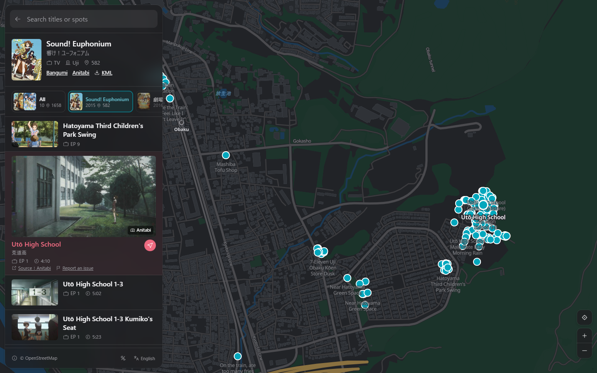

  

<h1 align="center">Anime Pilgrimage Map</h1>

<a href="https://junrei.jannchie.com">junrei.jannchie.com</a>

English · <a href="README.zh-CN.md">简体中文</a> · <a href="README.ja.md">日本語</a>

Anime Pilgrimage Map shows the real places that appear in anime and games on a map, with the matching frame, episode, timestamp and original source for each spot. It is meant for planning a route before a trip and for comparing the scene with what is in front of you on site.

It covers over 55,000 spots from about 1,900 titles, and all 31,000+ anime on Bangumi can be searched. The interface is available in Simplified Chinese, Traditional Chinese, Japanese and English.

## Why I built it

I used [Anitabi](https://www.anitabi.cn/map) for a long time, and its data is still the core of this map. These are the things I wanted that it did not give me:

- **More titles.** About 570 titles and 3,400 spots that Anitabi does not have were added by hand from fan field reports and anime-tourism.jp (see [Data sources](#data-sources)).
- **Episode and timestamp.** Where known, a spot shows the episode and the time in it where the scene appears. For many hand-added spots, they come from matching the frame against trace.moe, so the scene can be found again in the episode.
- **One series, one page.** Every season, sequel, film and OVA of a series opens together with all their spots, and can be narrowed to one title.
- **Search that tolerates spelling.** A title can be found by its Chinese, Japanese, English or romanized name. Simplified and Traditional characters, Japanese kanji forms, hiragana and katakana, and full-width and half-width letters match each other, so 「聖地巡禮」 finds 「圣地巡礼」.
- **Names in my language, and in the local one.** Titles, spot names and notes are shown in the interface language; the selected spot also shows its local name to match against signs on site. Machine-translated text is labeled as such.
- **From map to trip.** Each spot opens in Google Maps or Apple Maps for directions, and a whole title can be exported as KML for Google My Maps. Every view has its own URL, so a title, a spot or a search can be shared as a link.

## How to use it

Open <https://junrei.jannchie.com> and type a title or a place name into the search box.

- **Browse by area**: the home page lists the titles that have spots inside the current map view. Move the map to see the titles nearby.
- **Look at a spot**: select a spot in the list or on the map to see the frame, episode and time, a short note, and a link to the source.
- **Install as an app**: on a phone, choose "Add to Home Screen" in the browser to open the map from the home screen.

On a computer, press `?` to see the keyboard shortcuts.

Spots from adult titles (mostly bishōjo games) are included but hidden by default. They can be shown with "Show adult titles" in the menu behind the "© OpenStreetMap" button at the bottom of the page.

## Data sources

- [Anitabi](https://www.anitabi.cn/map): most of the spots and frames, synced daily.
- [Bangumi](https://bgm.tv): titles, alternative names, covers and series relations, via its [API](https://bangumi.github.io/api/) and its weekly [data archive](https://github.com/bangumi/Archive).
- Hand-added spots in [`sync/manual.json`](sync/manual.json), for titles Anitabi does not cover:
  - [舞台探訪アーカイブ](https://wikiwiki.jp/legwork/), a wiki that indexes fan field reports by title, and the fan pilgrimage blogs it lists;
  - fan pilgrimage blogs that Anitabi itself cites as sources;
  - [錦鮒出版 聖地巡礼特集](https://nishikibuna.web.fc2.com/EXTRA/seichi.html), field reports on bishōjo games;
  - [anime-tourism.jp](https://anime-tourism.jp) (Anime Tourism), its pilgrimage spot database.
- [trace.moe](https://trace.moe): its public [frame database](https://huggingface.co/datasets/soruly/trace.moe-database-dump) (CC0) is used to match screenshots to an episode and timestamp.
- [Wikidata](https://www.wikidata.org): city names in each language.
- [OpenFreeMap](https://openfreemap.org): the base map (© OpenStreetMap contributors, © OpenMapTiles), with terrain from [Terrain Tiles](https://registry.opendata.aws/terrain-tiles/).

Every spot names its source and links to the original page. Hand-added spots record only the location, episode, time and at most a one-line description written for this site; the text and photos of the original articles are not copied. Comparison photos taken by others are linked, not reposted.

## Reporting a problem

If a spot is in the wrong place, belongs to another title or episode, or no longer exists or cannot be entered, click "Report an issue" under that spot. It opens a GitHub issue with the title, spot and coordinates already filled in.

To suggest spots that are not on the map yet, [open an issue](https://github.com/Jannchie/junrei/issues/new) with a link to the field report or photos.

## License

Data from Anitabi is published under [CC BY-NC-SA 4.0](https://creativecommons.org/licenses/by-nc-sa/4.0/); this site uses it for non-commercial purposes only.

Running locally and the data pipeline: [docs/development.md](docs/development.md).
