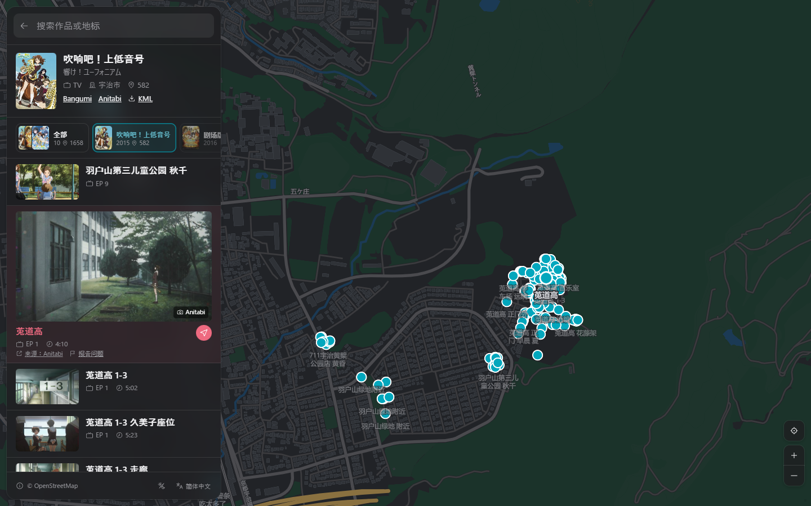

  

<h1 align="center">圣地巡礼地图</h1>

<a href="https://junrei.jannchie.com">junrei.jannchie.com</a>

<a href="README.md">English</a> · 简体中文 · <a href="README.ja.md">日本語</a>

圣地巡礼地图在地图上标出动画、游戏中出现过的真实地点，并为每个地点附上对应的画面、集数、时间点与原始出处，用于出行前规划路线，以及到现场后对照取景。

收录 5.5 万多个取景地点，涉及约 1900 部作品；Bangumi 上的 3.1 万多部动画均可搜索。界面提供简体中文、繁體中文、日本語与 English。

## 为什么做这个地图

我长期使用 [Anitabi](https://www.anitabi.cn/map)，它的数据至今仍是本站的主体。以下是我需要、而它没有提供的部分：

- **更多作品**：约 570 部作品、3400 个地点是 Anitabi 未收录的，依据粉丝的实地探访记录与 anime-tourism.jp 手动补充（见[数据来源](#数据来源)）。
- **集数与时间点**：已知时，地点会标出场景所在的集数与时间点。不少手动补充的地点通过 trace.moe 比对画面得出这两项，可以据此在正片中找回对应场景。
- **按系列浏览**：同一系列的各季、续作、剧场版与 OVA 合并在一个页面，显示全部地点，也可以只看其中一部。
- **不受写法影响的搜索**：作品可用中文、日文原名、英文名或罗马音搜索。简体与繁体、日文汉字字形、平假名与片假名、全角与半角之间互相匹配，例如输入「聖地巡禮」可以找到「圣地巡礼」。
- **当前语言与当地名称**：作品名、地点名与备注按界面语言显示；选中地点后另外给出当地语言的名称，便于对照现场的标牌。机器翻译的内容会注明。
- **从地图到行程**：每个地点可直接在 Google 地图或 Apple 地图中打开并导航；整部作品的地点可导出为 KML，导入 Google 我的地图。每个页面都有独立的链接，作品、地点与搜索结果都可以通过链接分享。

## 使用方法

打开 <https://junrei.jannchie.com>，在搜索框中输入作品名或地点名。

- **按区域查找**：首页列出当前地图范围内有取景地点的作品，移动地图即可查看附近的作品。
- **查看地点**：在列表或地图上选择地点，可查看画面、集数与时间点、简短说明，以及来源链接。
- **安装为应用**：手机浏览器中选择「添加到主屏幕」，即可从桌面打开。

在电脑上按 `?` 可查看键盘快捷键。

成人向作品（主要是美少女游戏）的取景同样收录，但默认隐藏，可点击页面底部的「© OpenStreetMap」按钮，在弹出的菜单中勾选「显示成人向作品」。

## 数据来源

- [Anitabi](https://www.anitabi.cn/map)：大部分取景地点与画面，每日同步。
- [Bangumi 番组计划](https://bgm.tv)：作品信息、别名、封面与系列关系，来自其 [API](https://bangumi.github.io/api/) 与每周发布的[数据包](https://github.com/bangumi/Archive)。
- [`sync/manual.json`](sync/manual.json) 中手动补充的地点，针对 Anitabi 未收录的作品：
  - [舞台探訪アーカイブ](https://wikiwiki.jp/legwork/)：按作品整理实地探访文章的 wiki，以及其中列出的粉丝巡礼博客；
  - Anitabi 自身引用过的粉丝巡礼博客；
  - [錦鮒出版 聖地巡礼特集](https://nishikibuna.web.fc2.com/EXTRA/seichi.html)：美少女游戏的实地探访记录；
  - [anime-tourism.jp](https://anime-tourism.jp)（Anime Tourism）的圣地巡礼数据库。
- [trace.moe](https://trace.moe)：使用其公开的[帧数据库](https://huggingface.co/datasets/soruly/trace.moe-database-dump)（CC0），将截图匹配到集数与时间点。
- [Wikidata](https://www.wikidata.org)：城市名的各语言名称。
- [OpenFreeMap](https://openfreemap.org)：地图底图（© OpenStreetMap contributors、© OpenMapTiles），地形数据来自 [Terrain Tiles](https://registry.opendata.aws/terrain-tiles/)。

每个地点都标明来源，并可跳转到原始页面。手动补充的地点只记录位置、集数、时间点，以及至多一句为本站撰写的说明，不转载原文的正文与照片。他人拍摄的对比图只提供链接，不转载。

## 报告问题

地点位置不准确、对应的作品或集数有误，或者地点已不存在、禁止进入，请点击该地点下方的「报告问题」。链接会打开一个已填好作品、地点与坐标的 GitHub issue。

想补充尚未收录的地点，可以[新建 issue](https://github.com/Jannchie/junrei/issues/new)，附上探访文章或照片的链接。

## 许可

来自 Anitabi 的数据以 [CC BY-NC-SA 4.0](https://creativecommons.org/licenses/by-nc-sa/4.0/) 许可发布，本站据此仅作非商业用途。

本地运行与数据处理流程见 [docs/development.md](docs/development.md)。
